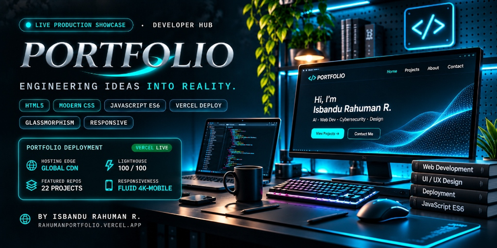

<p align="center">
  
</p>

# ◈ Personal Portfolio Website

[](https://github.com/ISBANDURAHUMAN-R/CODSOFT_taskno_PORTFOLIO/actions/workflows/ci.yml)

## ◆ About the Project
This repository contains a multi-page personal developer portfolio built with semantic HTML5, CSS3, and JavaScript during the CodSoft Web Development Internship. It organizes technical projects, programming skills, academic background, and contact channels into an accessible web experience.

## ❖ Key Features
- Modular multi-page structure separating Home, Projects, Skills, Experience, Achievements, and Contact sections.
- Comprehensive technical skills matrix displaying proficiencies in AI, Python, web development, and databases.
- Featured project showcase providing architectural summaries, technology tags, and direct repository links.
- Responsive mobile navigation with CSS styling.

## ◆ System Architecture

```mermaid
graph TD
    subgraph Navigation ["&nbsp; Multi-Page Static Site Architecture &nbsp;"]
        Index["&nbsp; index.html &nbsp;<br/>&nbsp; Hero &amp; Overview &nbsp;"]
        Projects["&nbsp; projects.html &nbsp;<br/>&nbsp; Repositories &nbsp;"]
        Skills["&nbsp; skills.html &nbsp;<br/>&nbsp; Full-Stack &amp; AI &nbsp;"]
        Experience["&nbsp; experience.html &nbsp;<br/>&nbsp; Career Timeline &nbsp;"]
        Achievements["&nbsp; achievements.html &nbsp;<br/>&nbsp; Certifications &nbsp;"]
        Contact["&nbsp; contact.html &nbsp;<br/>&nbsp; Social Channels &nbsp;"]
    end

    subgraph ClientCore ["&nbsp; Interactive Client Engine &nbsp;"]
        NavRouter["&nbsp; Navigation Controller &nbsp;<br/>&nbsp; &amp; Active Highlighter &nbsp;"]
        ThemeEngine["&nbsp; Theme Switcher &amp; &nbsp;<br/>&nbsp; Preference Store &nbsp;"]
        ScrollObserver["&nbsp; Intersection Observer &nbsp;<br/>&nbsp; &amp; Reveal FX &nbsp;"]
        FormHandler["&nbsp; Client Validation &amp; &nbsp;<br/>&nbsp; Contact Dispatcher &nbsp;"]
    end

    subgraph StylesheetLayer ["&nbsp; CSS3 Design System &nbsp;"]
        Tokens["&nbsp; Design Tokens: &nbsp;<br/>&nbsp; Colors • Typography &nbsp;"]
        Grid["&nbsp; CSS Grid Layout &nbsp;<br/>&nbsp; System &nbsp;"]
        Responsive["&nbsp; Media Query &nbsp;<br/>&nbsp; Breakpoints &nbsp;"]
    end

    Index & Projects & Skills & Experience & Achievements & Contact --> NavRouter
    Index & Projects & Skills & Experience & Achievements & Contact --> ThemeEngine
    Index & Projects & Skills & Experience & Achievements & Contact --> ScrollObserver
    Contact --> FormHandler
    Tokens --> Grid --> Responsive
```


## ⬢ Technologies Used
- HTML5
- CSS3
- JavaScript

## § Requirements
- Modern web browser

## ▲ Installation & Execution
```bash
# Open index.html directly or serve locally
python -m http.server 8000
```
Open `http://localhost:8000` in your web browser.

## ※ Developer
Developer: ISBANDU RAHUMAN R  
GitHub: https://github.com/ISBANDURAHUMAN-R
